<!-- Every card is an animated SVG drawn by scripts/render_readme_cards.py and refreshed daily
     by .github/workflows/update-profile-art.yml. Spacing is baked into the SVGs, so keep this
     block free of blank lines and keep each row of cards on one line with no spaces between them. -->

 
 
 
 
 
 
 
 

<a href="https://github.com/alejandroprix20-code">github</a> &nbsp;/&nbsp; <a href="https://www.linkedin.com/in/alejandro-horna-quezada-7b96ba200">linkedin</a>

